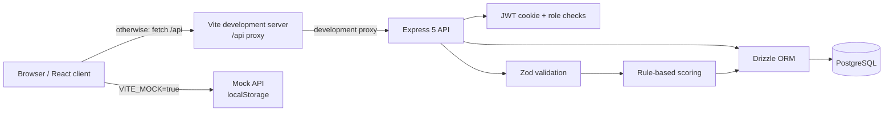
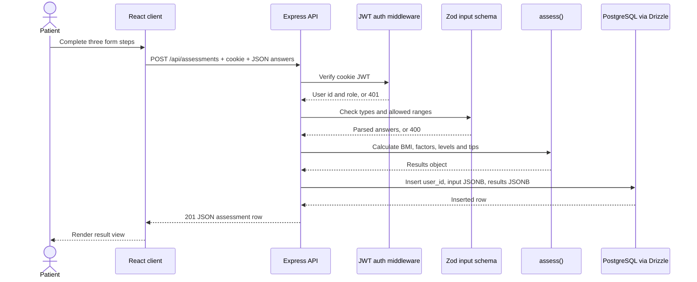
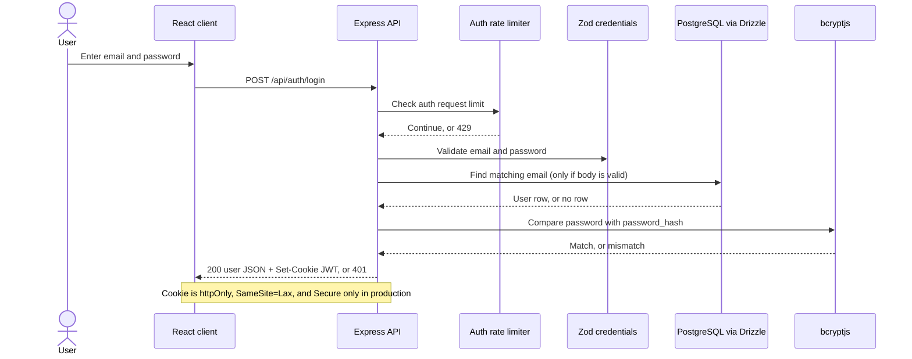

# 2. Architecture

## Three tiers

1. **Presentation tier — `client/`:** React and TypeScript render the sign-in flow, questionnaire, results, history, review list, and user-management table. Vite serves the frontend in development and proxies `/api` to the Express server.
2. **Application tier — `server/src/`:** Express exposes JSON endpoints, checks sessions and roles, validates request bodies with Zod, calls the scoring function, and reads or writes through Drizzle.
3. **Data tier — PostgreSQL:** Drizzle maps the `users` and `assessments` tables. Assessment inputs and results are JSONB values.

The mock mode is an alternate frontend data path: `client/src/api.ts` calls `client/src/mock.ts` when `VITE_MOCK` is exactly `"true"`. It stores demo state in browser `localStorage` and does not contact Express or PostgreSQL.

## Technologies and their observed roles

| Technology | Use visible in this repository |
|---|---|
| React | Composes the frontend into components and pages. |
| TypeScript | Types frontend data and server code; the client build runs `tsc --noEmit`. |
| Vite | Serves the development client on port 3000 and proxies `/api` to `http://localhost:8000`. |
| Node.js | Runs the server-side JavaScript/TypeScript runtime. |
| Express 5 | Routes HTTP requests, parses JSON, applies security middleware, and returns JSON responses. |
| Drizzle ORM / Drizzle Kit | Declares the schema, issues typed database queries, and pushes schema changes using `db:push`. |
| PostgreSQL | Stores users and assessments; JSONB holds assessment input and result objects. |
| Zod | Validates registration, login, assessment, and role-change request bodies. |
| `jsonwebtoken` | Signs and verifies the session JWT. |
| `bcryptjs` | Hashes registered passwords and compares login passwords. |
| `helmet` | Applies HTTP security headers through Express middleware. |
| `cookie-parser` | Makes parsed cookies available to the authentication middleware. |
| `express-rate-limit` | Limits requests to routes mounted under `/api/auth`. |

The code shows these technical roles. It does not record a formal decision log explaining the original selection rationale.

## Folder and important-file map

```text
.
├── README.md                         # Project summary and local commands
├── client/
│   ├── index.html                    # HTML entry point and viewport/font declarations
│   ├── package.json                  # Client scripts and dependencies
│   ├── vite.config.ts                # React plugin and /api development proxy
│   └── src/
│       ├── main.tsx                  # React root, BrowserRouter, and global CSS import
│       ├── vite-env.d.ts              # Vite client type declarations
│       ├── App.tsx                   # Session bootstrap, navigation, route access
│       ├── api.ts                    # API types, mock/real selection, fetch wrapper
│       ├── mock.ts                   # Browser localStorage mock API and demo users
│       ├── mockScoring.ts            # Offline copy of server scoring rules
│       ├── styles.css                # Global styles, responsive and print rules
│       └── pages/
│           ├── Login.tsx             # Registration and sign-in screen
│           ├── Assess.tsx            # Three-step assessment form and result flow
│           ├── ResultView.tsx        # Risk summaries, tips, print action
│           ├── Ruler.tsx             # Three-zone risk ruler
│           ├── History.tsx           # Patient's prior assessments
│           ├── Review.tsx            # Clinician/admin recent-assessment table
│           └── Admin.tsx             # Admin user list and role selector
└── server/
    ├── package.json                  # Server scripts and dependencies
    ├── drizzle.config.ts             # PostgreSQL schema path and migration output directory
    ├── scripts/smoke.mjs             # HTTP smoke checks against a running server
    └── src/
        ├── index.ts                  # Starts Express on PORT or 8000
        ├── app.ts                    # Middleware, route mounts, health and errors
        ├── auth.ts                   # JWT cookie settings and requireAuth middleware
        ├── scoring.ts                # Zod input schema and authoritative score rules
        ├── db/
        │   ├── client.ts             # PostgreSQL pool and Drizzle instance
        │   └── schema.ts             # users and assessments table definitions
        └── routes/
            ├── auth.ts               # Registration, login, logout, and current-user routes
            ├── assessments.ts        # Assessment creation, personal history, staff review
            └── admin.ts              # Admin user listing and role changes
```

## System architecture



In a production deployment the Vite development server is not the production API proxy. A production hosting/reverse-proxy arrangement is **not implemented** by the repository; see [setup and deployment](07-setup-and-deployment.md).

## Request flow: submit an assessment



## Request flow: login


