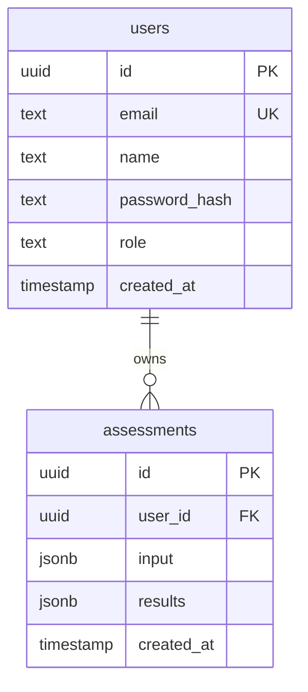

# 3. Database

The schema is defined in `server/src/db/schema.ts`. Drizzle Kit reads that file using `server/drizzle.config.ts`; the configured output directory is `server/drizzle`.

## Tables and columns

### `users`

| Column | PostgreSQL type | Constraints/default | Meaning |
|---|---|---|---|
| `id` | `uuid` | Primary key; `defaultRandom()` | Account identifier. |
| `email` | `text` | `NOT NULL`, `UNIQUE` | Login email. Registration validates and lowercases the email before insertion. |
| `name` | `text` | `NOT NULL` | Display name. |
| `password_hash` | `text` | `NOT NULL` | bcryptjs hash; the real API does not store the submitted password directly. |
| `role` | `text` | `NOT NULL`, default `"patient"`; Drizzle TypeScript enum choices are patient/clinician/admin | Access role. The schema declaration does not define a PostgreSQL enum or an explicit SQL `CHECK` constraint. |
| `created_at` | `timestamp without time zone` | `NOT NULL`, `defaultNow()` | Account creation time. `withTimezone` is not enabled in the schema. |

### `assessments`

| Column | PostgreSQL type | Constraints/default | Meaning |
|---|---|---|---|
| `id` | `uuid` | Primary key; `defaultRandom()` | Assessment identifier. |
| `user_id` | `uuid` | `NOT NULL`; foreign key to `users.id`; `ON DELETE CASCADE` | Owner of this assessment. Deleting a user cascades to their assessments. |
| `input` | `jsonb` | `NOT NULL` | Validated answers submitted for the assessment. |
| `results` | `jsonb` | `NOT NULL` | Calculated BMI, risk arrays, factors, levels, tips, and checkup flag. |
| `created_at` | `timestamp without time zone` | `NOT NULL`, `defaultNow()` | Assessment creation time. |

### Entity relationship

## JSONB use

The database stores the answer set and the complete calculated result object as JSONB rather than creating a column for every answer or every risk factor. This matches the request/response objects used in the application and lets one assessment row contain variable lists of factors and tips.

This is an implementation description, not a claim that JSONB is always preferable. The code does not store a scoring-rule version alongside a result. If scoring rules change, old JSONB results remain as calculated, but the schema does not record which rule version produced them.

## Data access notes

- Patient history is filtered by the authenticated user's ID and sorted newest-first.
- Staff review selects up to 100 recent assessments and returns the patient name and email plus results. It does not return the answers JSON in that query.
- Admin user listing returns IDs, names, emails, roles, and account creation times; it does not return password hashes.
- Database migrations beyond Drizzle Kit's `db:push` flow and backup/retention jobs are **not implemented** in the checked-in source.
